<a href="https://abdullahsido.framer.website/">
  <picture>
    <source media="(prefers-color-scheme: dark)" srcset="assets/header-dark.svg">
    
  </picture>
</a>

<p align="center">
  <a href="https://abdullahsido.framer.website/"></a>
  <a href="https://www.linkedin.com/in/abdullahsido"></a>
  <a href="mailto:abdullah.abosido2002@gmail.com"></a>
  
</p>

## About me

I'm a Flutter developer from Gaza, currently building production apps at **Optimiza**. I care about clean architecture, smooth UI and apps that feel fast on every device, Android and iOS alike.

```dart
class Abdullah extends Developer {
  final role       = 'Flutter Developer @ Optimiza';
  final location   = 'Gaza, Palestine';
  final focus      = ['Clean architecture', 'Pixel-perfect UI', 'Performance'];
  final state      = ['Riverpod', 'Bloc', 'GetX'];
  final backend    = ['Firebase', 'REST APIs', 'Node.js'];
  final openTo     = 'Freelance projects and meaningful collaborations';
}
```

## Tech stack

<p align="center">
  <a href="https://skillicons.dev">
    
  </a>
  <br>
  <a href="https://skillicons.dev">
    
  </a>
</p>

## Featured projects

<p align="center">
  <a href="https://github.com/aboodsido/wireless_mobile_controller"><picture><source media="(prefers-color-scheme: dark)" srcset="assets/projects/wireless_mobile_controller-dark.svg"></picture></a>
  <a href="https://github.com/aboodsido/pet"><picture><source media="(prefers-color-scheme: dark)" srcset="assets/projects/pet-dark.svg"></picture></a>
</p>

<p align="center">
  <a href="https://github.com/aboodsido/TaskManager-Pro"><picture><source media="(prefers-color-scheme: dark)" srcset="assets/projects/TaskManager-Pro-dark.svg"></picture></a>
  <a href="https://github.com/aboodsido/text_recognition_app"><picture><source media="(prefers-color-scheme: dark)" srcset="assets/projects/text_recognition_app-dark.svg"></picture></a>
</p>

<p align="center">
  <a href="https://github.com/aboodsido/Routes-Generator-App"><picture><source media="(prefers-color-scheme: dark)" srcset="assets/projects/Routes-Generator-App-dark.svg"></picture></a>
  <a href="https://github.com/aboodsido/chatty"><picture><source media="(prefers-color-scheme: dark)" srcset="assets/projects/chatty-dark.svg"></picture></a>
</p>

## GitHub activity

<p align="center">
  <picture>
    <source media="(prefers-color-scheme: dark)" srcset="assets/stats-dark.svg">
    
  </picture>
  <picture>
    <source media="(prefers-color-scheme: dark)" srcset="assets/languages-dark.svg">
    
  </picture>
</p>

<p align="center">
  <picture>
    <source media="(prefers-color-scheme: dark)" srcset="https://streak-stats.demolab.com/?user=aboodsido&hide_border=true&border_radius=16&background=0B1020&stroke=22304F&ring=13B9FD&fire=13B9FD&currStreakNum=E6EDF3&sideNums=E6EDF3&currStreakLabel=13B9FD&sideLabels=8B9BB4&dates=8B9BB4">
    
  </picture>
</p>

<p align="center">
  <picture>
    <source media="(prefers-color-scheme: dark)" srcset="https://raw.githubusercontent.com/aboodsido/aboodsido/output/snake-dark.svg">
    
  </picture>
</p>

<p align="center">
  <sub>Cards refresh daily via GitHub Actions · Let's build something meaningful together 💙</sub>
</p>
